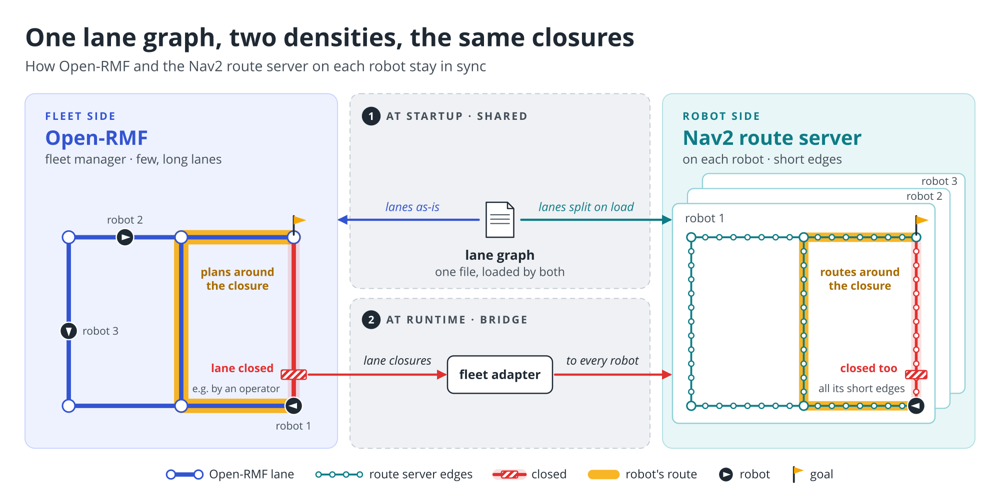
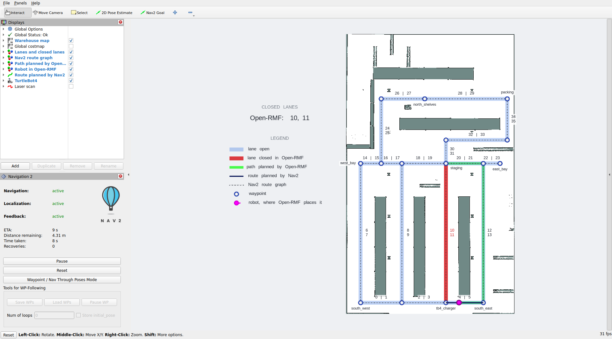

# Open-RMF ↔ Nav2 Route Sync Demo

A ready-to-run ROS 2 Jazzy workspace in which lane closures in Open-RMF reach the Nav2
route server. Open-RMF and the route server plan on the same lanes, and a simulated
TurtleBot4 avoids a closed lane even when its goal is sent straight to Nav2.



## What's in the workspace

| Repository | Role |
|---|---|
| [nav2_route_rmf](https://github.com/AIT-Assistive-Autonomous-Systems/nav2_route_rmf) | Route server plugins: load the Open-RMF nav graph, split its lanes into short edges, close lanes |
| [free_fleet](https://github.com/askokostic/free_fleet/tree/feat/nav2-route-sync), branch `feat/nav2-route-sync` | Open-RMF fleet adapter, extended to forward lane closures to the route server |
| [rmf_nav2_route_demo](https://github.com/askokostic/rmf_nav2_route_demo) | Warehouse site, configuration, launch files, RViz view |

## Setup

Open the workspace in VS Code and run **Dev Containers: Reopen in Container**. This
imports the repositories of [src/ros2.repos](src/ros2.repos) and builds the workspace.
Re-run `./build.sh` after source changes.

## Running the demo

```bash
ros2 launch rmf_nav2_route_demo demo.launch.py
```

Add `headless:=False` to open Gazebo's window. The demo is ready when RViz shows
**Navigation: active** and the launch terminal shows
`Successfully added robot [tb4] to the fleet [turtlebot4]`. The first start downloads
the warehouse models from Gazebo Fuel (about 50 MB).

Nav2 runs on ROS domain 0, Open-RMF on 55. New terminals are on 55; the Nav2 commands
below set `ROS_DOMAIN_ID=0`.

### What RViz shows



- **Lanes**: light blue when open, red when closed in Open-RMF. The numbers are the
  lane IDs, one per direction.
- **Closed lanes**, beside the map: the lanes Open-RMF holds closed. The route server
  logs how many lanes it holds closed after each change, in the launch terminal:
  `[route_server]: 2 RMF lanes closed, 0 repriced.`
- **Open-RMF's path** (green), **Nav2's route** (dark blue), and the route server's
  graph (grey dotted lines).
- The robot where Open-RMF places it (magenta disc), and the waypoints (blue circles).

### Walkthrough

The robot starts on `tb4_charger`, at the south end of aisle 2; `staging` is at its
north end.

**In sync**

1. Close aisle 2 (lanes 10 and 11) in Open-RMF:

   ```bash
   ros2 topic pub --once /lane_closure_requests rmf_fleet_msgs/msg/LaneRequest \
     "{fleet_name: turtlebot4, close_lanes: [10, 11]}"
   ```

   Aisle 2 turns red, and the route server logs `2 RMF lanes closed`.

2. Send the robot to `staging` with **Nav2 Goal** in RViz, or:

   ```bash
   ROS_DOMAIN_ID=0 ros2 topic pub --once /goal_pose geometry_msgs/msg/PoseStamped \
     "{header: {frame_id: map}, pose: {position: {x: 2.8, y: 2.0}, orientation: {w: 1.0}}}"
   ```

   The route goes around the closed aisle, through aisle 3.

**Out of sync**

3. When the robot has arrived, reopen the lanes in the route server only, as after a
   restart. The service takes lane IDs:

   ```bash
   ROS_DOMAIN_ID=0 ros2 service call /route_server/DynamicEdgesScorer/adjust_edges \
     nav2_msgs/srv/DynamicEdges "{opened_edges: [10, 11]}"
   ```

   The route server logs `0 RMF lanes closed`. Aisle 2 stays red: Open-RMF still
   holds it closed.

4. Send the robot back to `tb4_charger` with **Nav2 Goal**, or:

   ```bash
   ROS_DOMAIN_ID=0 ros2 topic pub --once /goal_pose geometry_msgs/msg/PoseStamped \
     "{header: {frame_id: map}, pose: {position: {x: 2.8, y: -23.0}, orientation: {w: 1.0}}}"
   ```

   The robot drives straight down the closed aisle.

**Back in sync**

5. When the robot has arrived, run the command of step 1 again. The route server logs
   `2 RMF lanes closed`.

6. Send the robot to `staging` with an Open-RMF task:

   ```bash
   ros2 run rmf_demos_tasks dispatch_go_to_place -p staging
   ```

   Open-RMF's path and Nav2's route both avoid the closed aisle.

7. Reopen aisle 2:

   ```bash
   ros2 topic pub --once /lane_closure_requests rmf_fleet_msgs/msg/LaneRequest \
     "{fleet_name: turtlebot4, open_lanes: [10, 11]}"
   ```

### Other lanes and places

| Lanes | Where |
|---|---|
| 6, 7 | west aisle |
| 8, 9 | aisle 1 |
| 10, 11 | aisle 2 (`tb4_charger` ↔ `staging`) |
| 12, 13 | aisle 3 |
| 26, 27 | north corridor (towards `north_shelves`) |
| 32, 33 | east passage |

Places for `dispatch_go_to_place -p`: `tb4_charger`, `staging`, `north_shelves`,
`packing`, `south_west`, `south_east`, `west_bay`, `east_bay`. Lane IDs are indices in
the generated nav graph, `install/share/rmf_nav2_route_demo/maps/warehouse/nav_graphs/0.yaml`.

### Changing the edge spacing

The route server splits the lanes into edges of at most 0.5 m, set by
`target_node_spacing` in `src/rmf_nav2_route_demo/config/nav2_params.yaml`. A change
applies at the next start, without a rebuild; `0.0` loads the lanes unsplit. At `0.0`,
send a new Nav2 goal while the robot is in the first half of an aisle: the route starts
at the start of the aisle, behind the robot.

## License

This project is licensed under the Apache License 2.0. See [LICENSE](LICENSE) for details.
